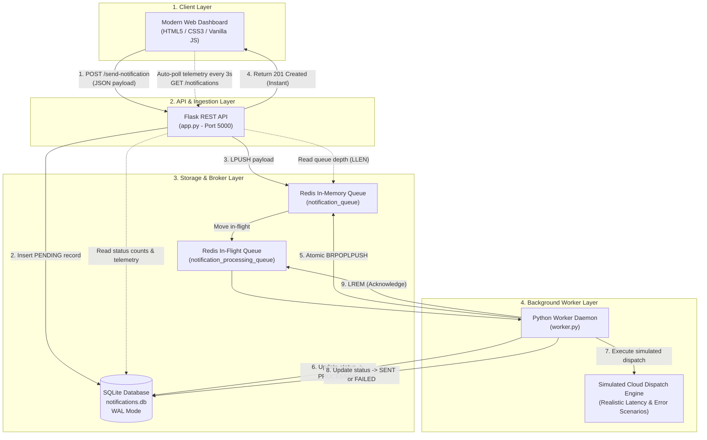

# Cloud-Based Notification System with Queue-Based Notification Delivery

A decoupled, scalable cloud computing web application built with **Flask**, **Redis**, **SQLite**, and **Python Background Workers**. Designed to demonstrate asynchronous message queuing, fault tolerance, and non-blocking cloud service architectures.

---

## Table of Contents
1. [Project Abstract](#1-project-abstract)
2. [Problem Statement](#2-problem-statement)
3. [Project Objectives](#3-project-objectives)
4. [Existing System vs. Proposed System](#4-existing-system-vs-proposed-system)
5. [System Architecture](#5-system-architecture)
6. [Technology Stack](#6-technology-stack)
7. [Module Descriptions](#7-module-descriptions)
8. [Database Schema](#8-database-schema)
9. [REST API Documentation](#9-rest-api-documentation)
10. [Setup & Execution Instructions (Windows / VS Code)](#10-setup--execution-instructions-windows--vs-code)
11. [Testing & Verification](#11-testing--verification)
12. [Advantages & Limitations](#12-advantages--limitations)
13. [Future Enhancements](#13-future-enhancements)
14. [College Faculty Presentation Guide (Viva Q&A)](#14-college-faculty-presentation-guide-viva-qa)
15. [Conclusion](#15-conclusion)

---

## 1. Project Abstract
In modern cloud computing and distributed systems, real-time user-facing applications must remain fast and responsive even when interacting with high-latency external services, such as SMTP servers, SMS gateways, or push notification dispatchers. 

The **Cloud-Based Notification System with Queue-Based Notification Delivery** demonstrates how to decouple incoming user requests from time-consuming delivery operations. When a user dispatches a notification, the Flask API immediately persists the record in an **SQLite** database with a `PENDING` status and pushes a lightweight message payload into an in-memory **Redis** message queue. An independent **Python Background Worker** asynchronously consumes tasks from the queue, updates the state to `PROCESSING`, performs simulated cloud dispatch, and records final completion (`SENT` or `FAILED`) with precise timestamps. A modern, glassmorphic dashboard provides real-time telemetry, queue depth tracking, search/filter controls, and retry capabilities.

---

## 2. Problem Statement
Traditional monolithic web applications typically handle notification delivery **synchronously** within the HTTP request-response cycle:
- **Server Blocking:** The web server thread is blocked waiting for external network I/O (SMTP handshake, network delays, rate limits).
- **Poor User Experience:** Users experience prolonged loading spinners, connection timeouts, or browser freezes (often 3–15 seconds per request).
- **Vulnerability to Traffic Spikes:** Under heavy traffic, blocked threads exhaust the application server's connection pool, leading to complete service outages (HTTP 504 Gateway Timeouts).
- **Cascading Failures:** If the third-party email provider is temporarily down or slow, the entire web application becomes unresponsive.

---

## 3. Project Objectives
1. **Asynchronous Decoupling:** Decouple notification intake from notification dispatch using an intermediate message broker (Redis).
2. **Sub-second Response Times:** Ensure the user-facing REST API responds in milliseconds with HTTP `201 Created`.
3. **Fault-Tolerant Delivery:** Guarantee zero message loss using reliable queue patterns (`BRPOPLPUSH` / Acknowledgement) with crash recovery.
4. **Real-time Observability:** Provide a responsive dashboard displaying status counts, Redis backlog, and live worker activity.
5. **Beginner-Friendly & Self-Contained:** Ensure seamless local execution on Windows without mandatory Docker or external paid cloud accounts.

---

## 4. Existing System vs. Proposed System

| Dimension | Existing System (Synchronous Monolith) | Proposed System (Queue-Decoupled Cloud Architecture) |
|---|---|---|
| **Architecture** | Coupled, monolithic single-process | Distributed, decoupled multi-process (API + Queue + Worker) |
| **Response Latency** | High (2,000ms – 10,000ms per email) | Ultra-low (< 50ms) |
| **Traffic Handling** | Vulnerable to request spikes and timeouts | High resilience; queue buffers spikes safely |
| **Failure Isolation** | Downstream email failures crash the HTTP request | Worker failures are isolated; API continues accepting requests |
| **Scalability** | Horizontal scaling requires duplicating the entire app | Worker processes can scale horizontally based on queue depth |
| **User Feedback** | Browser hangs until delivery finishes | Immediate receipt confirmation + live background progress updates |

---

## 5. System Architecture



### Decoupled Workflow Sequence
1. **Submission:** User fills recipient email, subject, and message in the dashboard.
2. **Validation & Persist:** Flask validates input, creates a unique UUID, and inserts a row in SQLite with status `PENDING`.
3. **Enqueue:** The notification is pushed into Redis (`notification_queue`).
4. **Immediate Response:** Flask returns HTTP `201` with the notification ID. Total time: **~15ms**.
5. **Worker Pickup:** `worker.py` atomically pops the item into `notification_processing_queue` via `BRPOPLPUSH`.
6. **Processing:** The worker marks status as `PROCESSING` in SQLite, introduces a realistic simulation delay, and logs each step.
7. **Resolution:**
   - On success: status is set to `SENT` and `sent_at` timestamp is recorded.
   - On triggered failure (e.g., test emails containing `fail` or `reject`): status is set to `FAILED` with detailed diagnostic error text.
8. **Acknowledgement:** The worker removes the item from the processing queue (`LREM`).
9. **UI Refresh:** The client dashboard auto-refreshes every 3 seconds to reflect updated states without manual reloading.

---

## 6. Technology Stack
- **Frontend:**
  - HTML5 (Semantic, accessible layout)
  - CSS3 (Curated HSL design system, Glassmorphism, Dark/Light modes, responsive flex/grid)
  - JavaScript (ES6+ modular controller, Fetch API, live polling, toast notifications)
- **Backend:**
  - Python 3.10+
  - Flask 3.x (Lightweight WSGI REST API)
  - SQLite3 with **WAL (Write-Ahead Logging)** mode for concurrent multi-process access
- **Message Broker & Queuing:**
  - Redis 7.x (via `redis-py` client)
  - Reliable queue pattern (`BRPOPLPUSH` / Ack)
  - `redis_dev_server.py` (built-in pure-Python standalone Redis TCP server for zero-setup Windows execution)
- **Worker & Async Execution:**
  - Standalone Python daemon (`worker.py`)
- **Testing:**
  - `pytest` (12 comprehensive automated test cases)
  - `fakeredis` (in-memory mock Redis for isolated unit testing)

---

## 7. Module Descriptions

```
cloud_notification/
├── app.py                # Flask REST API: routing, validation, error handlers, and dashboard serving
├── worker.py             # Background daemon: listens to Redis queue, updates SQLite, simulates delivery
├── database.py           # Database access layer: SQLite connection pooling, WAL mode, CRUD queries
├── queue_service.py      # Redis wrapper: reliable pop, push, acknowledgements, health checks
├── redis_dev_server.py   # Pure-Python standalone Redis TCP server for zero-setup Windows running
├── requirements.txt      # Python dependencies
├── .env.example          # Environment variable template
├── .gitignore            # Git ignore configuration
├── templates/
│   └── index.html        # Interactive HTML5 dashboard template
├── static/
│   ├── css/
│   │   └── style.css     # Complete design system with dark/light themes and glassmorphic cards
│   └── js/
│       └── app.js        # Dynamic frontend controller: polling, presets, validation, modals
└── tests/
    └── test_api.py       # 12 automated unit and integration tests covering all edge cases
```

---

## 8. Database Schema

### Table: `notifications`
Database engine: **SQLite3** (`notifications.db`) with Write-Ahead Logging (`PRAGMA journal_mode=WAL;`).

| Column | Data Type | Constraints | Description |
|---|---|---|---|
| `id` | `TEXT` | `PRIMARY KEY` | Globally unique notification identifier (UUIDv4) |
| `email` | `TEXT` | `NOT NULL` | Recipient email address |
| `subject` | `TEXT` | `NOT NULL` | Notification title / subject line |
| `message` | `TEXT` | `NOT NULL` | Notification message body |
| `status` | `TEXT` | `NOT NULL CHECK(status IN ('PENDING', 'PROCESSING', 'SENT', 'FAILED'))` | Current lifecycle state |
| `created_at` | `TEXT` | `NOT NULL` | ISO 8601 UTC submission timestamp |
| `sent_at` | `TEXT` | `NULL` | ISO 8601 UTC completion timestamp (populated on `SENT`) |
| `error` | `TEXT` | `NULL` | Diagnostic error message (populated on `FAILED`) |

### Indexes
- `idx_notifications_status` on `notifications(status)` for fast filter tab queries.
- `idx_notifications_created_at` on `notifications(created_at DESC)` for chronological ordering.

---

## 9. REST API Documentation

### 1. `GET /`
- **Description:** Serves the interactive web dashboard.
- **Response:** `200 OK` (HTML)

### 2. `POST /send-notification`
- **Description:** Validates input, saves record to SQLite, and enqueues payload into Redis.
- **Request Body (JSON):**
  ```json
  {
    "email": "student@college.edu",
    "subject": "Cloud Lab Assignment Graded",
    "message": "Your submission for Cloud Project has received an A grade."
  }
  ```
- **Responses:**
  - `201 Created`:
    ```json
    {
      "success": true,
      "message": "Notification successfully queued for delivery (Simulated).",
      "notification_id": "6a3cfd16-e165-4fb2-adb7-644010d9cffb",
      "status": "PENDING",
      "created_at": "2026-10-20T07:17:02.674184+00:00"
    }
    ```
  - `400 Bad Request`: When required fields are missing or email format is invalid.
  - `503 Service Unavailable`: When Redis is unreachable (prevents reporting success for unqueued jobs).

### 3. `GET /notifications`
- **Description:** Returns notification history, status counts, and queue depth.
- **Query Parameters (Optional):**
  - `status`: `ALL` (default), `PENDING`, `PROCESSING`, `SENT`, `FAILED`
  - `search`: Keyword matching email, subject, or ID
  - `limit`: Number of records (default: 100)
- **Response `200 OK`:**
  ```json
  {
    "success": true,
    "counts": {
      "total": 12,
      "sent": 9,
      "pending": 1,
      "processing": 1,
      "failed": 1
    },
    "queue": {
      "connected": true,
      "waiting": 1,
      "processing": 1,
      "total_queued": 2,
      "queue_name": "notification_queue"
    },
    "notifications": [ ... ]
  }
  ```

### 4. `GET /notifications/<id>`
- **Description:** Retrieve full details of a specific notification.
- **Response `200 OK`:** Notification JSON object.

### 5. `POST /retry-notification/<id>`
- **Description:** Re-queues a failed notification back into Redis with status reset to `PENDING`.
- **Response `200 OK`:** Enqueue confirmation.

### 6. `GET /queue-status`
- **Description:** Returns real-time Redis queue depth metrics.
- **Response `200 OK`:** `{ "success": true, "metrics": { "waiting": 0, "processing": 0, "connected": true } }`

### 7. `GET /health`
- **Description:** Comprehensive health check of Flask, SQLite, and Redis connection.
- **Response `200 OK`:**
  ```json
  {
    "status": "healthy",
    "services": {
      "database": { "engine": "SQLite", "status": "connected" },
      "message_queue": { "engine": "Redis", "status": "connected", "host": "127.0.0.1", "port": 6379 }
    }
  }
  ```

### 8. `POST /api/clear-history`
- **Description:** Clears SQLite records for demonstration reset.

---

## 10. Setup & Execution Instructions (Windows / VS Code)

All steps use **Windows PowerShell** inside the project folder (`c:\Users\jamee\Desktop\cloud_notification`).

### Step 1: Create and Activate Virtual Environment
Open PowerShell:
```powershell
# Create Python virtual environment
python -m venv venv

# Activate virtual environment
.\venv\Scripts\Activate.ps1
```
*(If PowerShell displays an execution policy error, run `Set-ExecutionPolicy -Scope Process -ExecutionPolicy Bypass` first).*

### Step 2: Install Dependencies
```powershell
pip install -r requirements.txt
```

---

### Step 3: Start the Redis Server
Choose **one** of the following options:

#### Option A: Built-in Redis Dev Server (Zero Setup — Recommended for Windows)
No Docker, WSL, or Windows installer required!
```powershell
# Open Terminal 1
python redis_dev_server.py
```
*Listens on standard port `127.0.0.1:6379` using pure Python TCP socket server.*

#### Option B: Memurai (Native Redis for Windows)
Download and run Memurai Developer Edition from [memurai.com](https://www.memurai.com/). It runs as a native Windows service on port 6379.

#### Option C: Docker (if available)
```powershell
docker run -d --name redis-notify -p 6379:6379 redis:alpine
```

---

### Step 4: Start the Flask Application
In a **second terminal** (with `venv` activated):
```powershell
# Open Terminal 2
.\venv\Scripts\Activate.ps1
python app.py
```
*The web server will start at: `http://127.0.0.1:5000`*

---

### Step 5: Start the Background Worker
In a **third terminal** (with `venv` activated):
```powershell
# Open Terminal 3
.\venv\Scripts\Activate.ps1
python worker.py
```
*The worker will initialize, recover any in-flight tasks, and display real-time colored logs as it processes incoming tasks.*

---

### Step 6: Access the Dashboard
Open your browser and navigate to:
```
http://127.0.0.1:5000
```

---

## 11. Testing & Verification

### Automated Test Suite
Run the 12 automated unit and integration tests using `pytest`:
```powershell
.\venv\Scripts\Activate.ps1
pytest tests/test_api.py -v
```

**Expected output:**
```
tests/test_api.py::test_index_dashboard PASSED             [  8%]
tests/test_api.py::test_health_check_endpoint PASSED       [ 16%]
tests/test_api.py::test_send_notification_valid PASSED     [ 25%]
tests/test_api.py::test_send_notification_missing_fields PASSED [ 33%]
tests/test_api.py::test_send_notification_invalid_email PASSED  [ 41%]
tests/test_api.py::test_get_notifications_and_counts PASSED[ 50%]
tests/test_api.py::test_queue_status_endpoint PASSED       [ 58%]
tests/test_api.py::test_retry_failed_notification PASSED   [ 66%]
tests/test_api.py::test_redis_down_returns_503 PASSED      [ 75%]
tests/test_api.py::test_worker_processing_success PASSED   [ 83%]
tests/test_api.py::test_worker_processing_failure PASSED   [ 91%]
tests/test_api.py::test_empty_history_and_clear PASSED     [100%]
====================== 12 passed in 0.82s ======================
```

---

### Manual Verification Scenarios via PowerShell

#### Scenario A: Submit Valid Notification
```powershell
$body = @{
    email = "faculty@college.edu"
    subject = "Project Review"
    message = "Demonstration of asynchronous cloud notification pipeline."
} | ConvertTo-Json

Invoke-RestMethod -Uri "http://127.0.0.1:5000/send-notification" -Method POST -Body $body -ContentType "application/json"
```

#### Scenario B: Trigger Simulated Delivery Failure
Any email containing `fail`, `error`, or `reject` triggers a simulated SMTP rejection:
```powershell
$body = @{
    email = "fail-test@reject.domain.com"
    subject = "Delivery Failure Test"
    message = "Testing error capture and retry."
} | ConvertTo-Json

Invoke-RestMethod -Uri "http://127.0.0.1:5000/send-notification" -Method POST -Body $body -ContentType "application/json"
```

#### Scenario C: Verify Queue and Health Status
```powershell
Invoke-RestMethod -Uri "http://127.0.0.1:5000/health"
Invoke-RestMethod -Uri "http://127.0.0.1:5000/queue-status"
```

---

## 12. Advantages & Limitations

### Advantages
1. **High Throughput & Non-Blocking:** The API accepts notifications in milliseconds regardless of email delivery latency.
2. **Horizontal Scalability:** Multiple worker instances can run in parallel across different servers or containers pulling from the same Redis queue.
3. **Resilience & Zero Message Loss:** The `BRPOPLPUSH` reliable queue pattern ensures that even if a worker crashes midway, the task remains in `notification_processing_queue` and is recovered upon restart.
4. **Offline Demonstrability:** Built-in dev server and simulated dispatcher allow college students to demo anywhere (including offline lab exams) without requiring external SMTP credentials or internet access.
5. **Modern UX:** Dark/light mode, live sync polling, character counting, and quick demo presets.

### Limitations
1. **Simulated Delivery by Default:** Does not connect to live SMTP servers (SendGrid, Mailgun, Amazon SES) without explicit cloud credentials.
2. **Local Redis Dependency:** Requires either the local dev server, Memurai, or Docker container to be active.
3. **Single Database File:** SQLite is suited for development and moderate loads; high-scale production systems would utilize PostgreSQL or AWS DynamoDB.

---

## 13. Future Enhancements
1. **Live Cloud Provider Integration:** Add optional environment variables (`SMTP_HOST`, `SENDGRID_API_KEY`) to enable real email sending with one toggle.
2. **Multi-Channel Dispatch:** Expand beyond email to SMS (Twilio), Push Notifications (Firebase FCM), and Slack webhooks.
3. **Dead Letter Queue (DLQ):** Automatically move notifications that fail more than 3 consecutive retries into a permanent DLQ for inspection.
4. **WebSocket Push:** Upgrade from HTTP polling to WebSockets (Flask-SocketIO) or Server-Sent Events (SSE) for sub-second push updates.
5. **Priority Queues:** Implement high, medium, and low priority Redis queues (e.g. OTPs processed before marketing blasts).

---

## 14. College Faculty Presentation Guide (Viva Q&A)

Here are key questions your evaluators may ask during your project demonstration, along with clear answers:

### Q1: Why did you use Redis instead of writing notifications straight to the database?
> **Answer:** Writing directly to a database and having a worker scan table rows (`SELECT * WHERE status='PENDING'`) causes database lock contention, slow polling queries, and poor scalability under load. Redis operates purely in-memory with O(1) atomic queue operations (`LPUSH`, `BRPOPLPUSH`), acting as a lightning-fast buffer between the web API and background workers.

### Q2: What happens if the worker process crashes while processing a notification?
> **Answer:** We implemented the **reliable Redis queue pattern**. Instead of a simple `RPOP` (which destroys the message immediately upon retrieval), the worker uses `BRPOPLPUSH`. This atomically moves the task from `notification_queue` to `notification_processing_queue`. If the worker crashes, the notification remains safely stored in the in-flight list. On worker boot, the `recover_abandoned_tasks()` routine re-enqueues any unacknowledged tasks, guaranteeing zero message loss.

### Q3: How does SQLite handle concurrent reads and writes from both Flask and the Worker?
> **Answer:** We configured SQLite with **Write-Ahead Logging (`WAL`) mode** and a 5,000ms busy timeout (`PRAGMA journal_mode=WAL;`). In standard rollback journal mode, writers block readers. In WAL mode, SQLite allows concurrent readers while a writer appends to the log, allowing Flask and the Worker to operate simultaneously without locking errors.

### Q4: Why is the delivery simulated in this project?
> **Answer:** Third-party cloud mail APIs (SendGrid, Amazon SES) require paid accounts, verified domain names, and active internet connectivity, which can fail or incur costs during college lab evaluations. The simulated dispatcher introduces authentic network delays (2 seconds) and realistic SMTP response codes (`550 Recipient rejected`) so faculty can test success and failure handling reliably in any environment.

---

## 15. Conclusion
The **Cloud-Based Notification System with Queue-Based Notification Delivery** effectively demonstrates the core architectural patterns of modern cloud computing: **loose coupling**, **asynchronous execution**, and **resilient message queuing**. By combining Flask, Redis, SQLite, and Python daemons, the project bridges theoretical cloud concepts with practical, production-grade software design.
